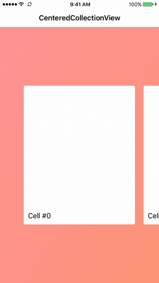

# CenteredCollectionView
[](https://github.com/BenEmdon/CenteredCollectionView/actions/workflows/ci.yml)
[](http://cocoapods.org/pods/CenteredCollectionView)
[](https://github.com/Carthage/Carthage)
[](https://github.com/apple/swift-package-manager)
[](https://swift.org)
[](https://swiftpackageindex.com/BenEmdon/CenteredCollectionView)
[](https://swiftpackageindex.com/BenEmdon/CenteredCollectionView)
[](http://cocoapods.org/pods/CenteredCollectionView)

`CenteredCollectionView` is a lightweight drop in place `UICollectionViewFlowLayout` that _pages_ and keeps its cells centered, resulting in the _"carousel effect"_ 🎡

## Example



To try the example using Cocoapods:
```bash
pod try CenteredCollectionView
```

## Requirements
This pod requires a deployment target of iOS 13.0 or greater

## Installation

CenteredCollectionView is available through [Swift Package Manager](https://swift.org/package-manager/), [CocoaPods](http://cocoapods.org) and [Carthage](https://github.com/Carthage/Carthage).

To install it with **Swift Package Manager**, add the URL `https://github.com/BenEmdon/CenteredCollectionView` in Xcode Add Package Dependency assistant ; or add to your own `Package.swift`:
```swift
dependencies: [
  .package(url: "https://github.com/BenEmdon/CenteredCollectionView", from: "2.3.0")
]
```

To install it with **Cocoapods**, add the following line to your `Podfile`:
```ruby
pod "CenteredCollectionView"
```

To install it with **Carthage**, add the following line to your `Cartfile`:
```
github "BenEmdon/CenteredCollectionView"
```

## Usage
Checkout [`USAGE.md`](/USAGE.md)

## API
Checkout [`API.md`](/API.md)

## Contributing

Have a suggestion? All contributions are welcome!

Issues and pull requests are triaged on a best effort basis, usually once a week. There is no stale bot here: a report from a real person stays open until a person answers it.

## Author

[@BenEmdon 👨‍💻](https://twitter.com/BenEmdon)

## License

CenteredCollectionView is available under the MIT license. See the LICENSE file for more info.
